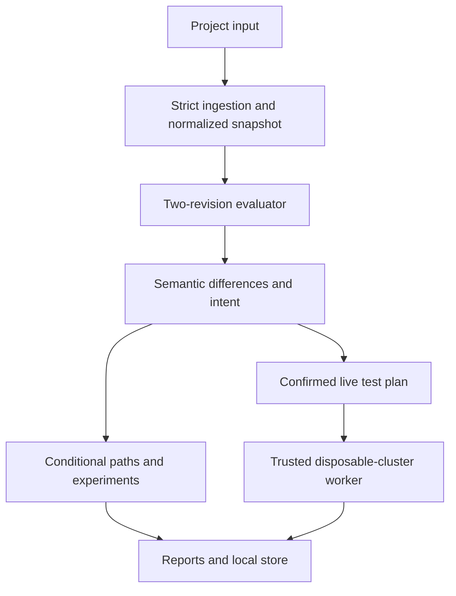

# Architecture and engineering decisions

## System boundary

NetScope is a local modular application. A pure analysis core has no cluster credentials, filesystem side effects, or HTTP dependency. CLI and FastAPI call `review_project`. A separate worker thread owns explicitly configured real-cluster operations; the browser cannot submit arbitrary kubectl commands or container programs.

## Important contracts

1. **One topology per comparison.** Endpoint IDs are namespace/name, independent of a live Pod UID. Templates are explicitly different from live snapshots.
2. **Policy union and directional isolation.** No policy priority or last-rule-wins semantics. A new Allow policy can introduce isolation, so the monotonicity property is used only when isolation is unchanged.
3. **Unknown is preserved.** Unsupported influencing policy kinds and unresolved IP/host/self cases cannot silently become a complete pass.
4. **Query coverage is explicit.** The finite declared query set is not universal connectivity. Intent expansion adds its tuples even when explicit queries omit them.
5. **Intent and change approval are independent.** A matching approval clears only its exact change gate. Candidate failures, Unknown, conflicts, and zero matches never pass.
6. **Static decisions and runtime observations differ.** Reports retain the distinction. Healthy controls and stable identities are prerequisites for conclusive observations.
7. **Counterfactuals are immutable forks.** Repair proposals and assumption changes become new reviews. Saved parent reports are unchanged.
8. **Reducer preservation is local to a witness.** Both decisions, four isolation flags, and selected candidate intent violations stay equal. Topology remains semantically fixed; unrelated behaviour is not claimed equivalent.
9. **Durable acknowledgement follows storage.** Snapshot files are flushed and atomically renamed before their transactional database references commit. Full storage refuses new work. Restarted active jobs become interrupted.
10. **No imported execution.** Workload execution fields are discarded from persisted input. Trusted probe/listener code is fixed in `runtime/fixture.py`; live operations use argv-based subprocess calls and ownership/UID checks.

## Algorithms and bounds

- **Evaluation:** target-policy selection is cached by endpoint/direction. Rules combine peer matching and protocol/destination-port matching. The finite-query bound is O(QR); the benchmark covers all 17,400 two-revision queries, traces, intent, and report construction.
- **Conditional containment:** breadth-first search on known Allow edges. Only the start and declared pivot workloads can expand the search. Maximum depth four; deterministic ordering; one shortest path per entrypoint/asset. O(V+E) per entrypoint under the depth bound. Sensitivity removes each pivot used in a witness and searches again, with results cached per entrypoint/pivot: at most P additional searches per entrypoint. It can return an alternate witness but does not enumerate every possible path. Port declarations are evidence metadata, never a prerequisite for numeric policy permission.
- **Repair:** deterministic combinations of changed policy identities, reverting baseline content or removing newly created policies. Up to 16 changed identities, subset size at most three, 64 reviews or ten seconds. Every result is fully re-evaluated; this is not arbitrary policy synthesis or a universal least-privilege optimizer.
- **Reduction:** sorted paired-identity deletion with restart after each accepted removal. The predicate is non-monotonic. Complete termination yields 1-minimality under that deletion operation, not a global minimum. Bound: 2,000 predicate calls or 30 seconds. Deadline-limited searches can end at different points on different machines and never claim minimality.
- **Fault injection:** deterministic bounded modifications, at most 24 unique mutants. Effectiveness and intent sensitivity are computed on the declared scope, not labelled as ground-truth correctness.
- **Check suggestions:** hash-sort the bounded fault suite and hold out every fourth candidate. Greedily select connection assertions covering missed effective training faults, at most 12 drafts by default. Held-out verdicts are never used in selection; selected assertions are verified against the reference. No minimum-size or out-of-generator generalization guarantee is claimed. The time budget is checked between fault evaluations, not a hard preemptive process limit.
- **Label experiments:** replace one explicit Pod's labels in a validated fork; materialize the original query set, then permit mandatory intent expansion. Compare reference/edited candidate permissions and asset paths only on shared tuples. Report additional intent tuples separately, so newly queried edges are not mistaken for newly opened edges. Distinguish new asset pairs from shorter paths to an already reachable asset.

## Persistence and interface

`store.py` keeps review metadata in SQLite and immutable project/report JSON in run directories. Live jobs persist state and partial evidence in SQLite, including requested mutations before they execute. Inputs are bounded to 5 MiB; new work is rejected above 100 reviews/1 GiB. There is no automatic deletion.

The browser gets one local write token. Mutating calls require the token and a matching Origin when supplied. The server binds to loopback and permits local hosts. The UI uses no remote scripts/fonts, has a restrictive content policy, escapes dynamic values, supports keyboard inspection, and uses status text alongside colour.

The app is designed for a single local reviewer, not a multi-tenant hosted service. There is one real-cluster worker lock per server process. Run one Uvicorn process when live verification is enabled; multiple processes would require a cross-process lease.

## Runtime evidence

The runner creates new exclusive namespaces with original modelled names/labels, then trusted fixture Pods. It tests unrestricted planned connections and known allow/deny controls, reconciles full B/C policy sets, confirms read-back, waits, and makes fresh TCP/UDP attempts. It records input/plan/revision hashes, tool/Kubernetes/CNI identity, resolved image IDs, endpoint UIDs/IPs, attempt timestamps/errors, controls, drift, and cleanup leftovers.

Release 1.2 records each Pod's actual node assignment, includes node placement in the drift snapshot, and runs UDP allow/deny controls when the plan includes UDP. A derived matrix joins observations to every planned tuple/revision. Missing observations stay `NOT_TESTED`; one tested revision never counts as both. Counts distinguish the full static scope, planned connections, conclusive observations, and observed same/cross/unknown node placement. Placement is not forced, and a conclusive mismatch remains a mismatch.

A valid response against Deny is unexpected reachability. Three failed attempts with healthy controls establish observed unreachability, not policy causation. Mixed Allow outcomes, errors, drift, or failed controls are inconclusive. Cleanup uses a DeleteOptions UID precondition and waits for namespace deletion; uncertain creates and failed cleanup remain explicit leftovers. A hard process crash may leave owned resources requiring operator inspection; it never resumes a previously complete verification automatically.
